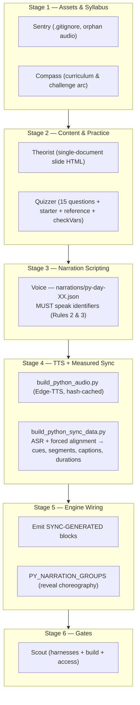

# Maestro — Python Day Orchestration Protocol
### Master System Specification (v5.0 — Measured Narration Sync Engine)

This skill governs the end-to-end multi-agent production line, data contracts, visual synchronization rules, and quality gates for **Python Day 01 through Day 30** in the Manodemy learning studio.

For lesson presentation or shared styling, also use [Course Design](../course-design/SKILL.md): record a continuity brief, select teaching patterns by learner confusion, and verify Read/Watch states on desktop/mobile in both themes. Its v1 candidate baseline uses `public/python/course-design.css`, mirrored to `python/course-design.css`, with initial adoption on Day03 only; Days01/02 remain untouched references. Parity means preserving relevant learning/runtime contracts, not copying whole-day CSS or restoring Day02's removed intro showcase grid. Keep useful concept diagrams and recall hooks. Candidate screenshots are not user-approved gold; counts or self-ratings do not establish a complete pass.

The codenames below are domain responsibilities assigned to the existing nine specialists through [Maestro routing](../../../.maestro/README.md), not additional permanent agents. Course Design owns presentation decisions; this skill retains measured audio, grading and engine contracts. Existing authorization covers routine in-scope implementation, not broad migrations or deployment.

**Delivery scope controls gate applicability.** Content/design tasks may complete in study mode with complete explanations, text solutions, honest media availability and disabled unavailable playback controls. Day03 has no MP3 assets for the initial course-design adoption; audio synthesis is outside that request. Apply the audio production stages and narrated-release gates below when a narrated release is in scope. Otherwise record them as out of scope, preserve existing runtime behavior, and run affected regressions without claiming full audio-sync parity. A future UI/content task does not automatically require audio regeneration; assess whether its authorized deliverable includes narration affected by the change.

> **v5.0 supersedes v4.0.** Every rule below was hardened against Python Day 01 production. Where v4.0 told agents to hand-enter durations, guess cue timestamps, or type code to an even cadence, v5.0 requires **measured** values produced by a reproducible pipeline. Do not reintroduce hand-entered numbers.

---

## ⚠️ 0. The Nine Rules That Break Days

These are the failure modes that actually occurred in Day 01. Each is enforced by a gate in §7.

| # | Rule | Why it matters |
|---|---|---|
| 1 | **Never hand-enter a duration.** Durations are measured from the MP3s by `build_python_sync_data.py`. | A stale `durations[]` or `slides[].duration` silently desynced the lesson badge from the timeline (showed `3:58` vs a real `13:41`). |
| 2 | **Narration must describe the code line-by-line, not conceptually.** | Q13/Q14 narrations explained the *algorithm* and never mentioned their own literals → 20 of 21 segments had no spoken anchor and typing was pure guesswork. |
| 3 | **Every graded identifier must be spoken aloud.** | `fraud_map`, `flatten_dict`, `flat`, `jump_sizes` are required by `checkVars` but were never narrated — audio-only learners could not produce a passing submission. |
| 4 | **Anchor to single exact words, not fuzzy phrases.** | `"first, loading and transforming massive datasets"` drifted **+5.38s**; `"second, building end to end automated etl pipelines"` failed to match at all. |
| 5 | **Anchored timestamps are immutable.** | Overflow repair used to rescale the whole ladder, dragging already-correct anchors **4–6s early**. |
| 6 | **Anchors must never bind to the preamble.** | `is_full_time` → alias `["is"]` matched *"Here **is** the solution"*, starting code 1.66s before the narrator began. Implemented by `_preamble_floor()` in the builder. |
| 7 | **Multi-word identifiers need explicit aliases.** | Splitting on `_` reduces `is_full_time` to `is`, which is a homophone magnet. |
| 8 | **A reveal group must never hide its own wrapper.** | Listing `.py-matrix-table` as a group item made every item "upcoming" during the intro, blanking the whole table for 12s. |
| 9 | **Never round-trip UTF-8 files through PowerShell `Get-Content`/`Set-Content`.** | `Get-Content` decodes as CP1252; writing back double-encoded every emoji into mojibake across 38 lines. |

---

## 👥 1. Subagent Roster & Operational Boundaries

| Codename | Role | Primary Inputs | Deliverables & Artifacts |
|:---|:---|:---|:---|
| **Sentry** | Asset & Storage Inspector | Raw workspace audio, `.gitignore` | 1) `public/python/DayXX/` structure<br>2) `.gitignore` whitelist verification (`!public/python/**/*.mp3`)<br>3) **Orphan audio report** (files with no script *and* no track reference) |
| **Theorist** | Theory Slide Authoring | Python curriculum & syllabus | `public/python/content/py-day-XX.js` — one unified continuous document, `#dayXX…` section IDs, SVG inline audio buttons, spotlight-target classes |
| **Quizzer** | Practice Challenges & Test Rubrics | Topic syllabus & Interview arcs | 15 practice questions with prompt, starter code, reference solution, `checkVars`, and Pyodide validation |
| **Voice** | Narration Script & TTS Synthesis | Slide content & Solution code | 1) `narrations/py-day-XX.json`<br>2) Edge-TTS MP3s (`en-US-AndrewNeural`, `-2%` rate, `+1Hz` pitch) via `scripts/build_python_audio.py` |
| **Sync** | Narration & Visual Directing | Theory MP3s + Solution code | 1) `LECTURE_CUES` anchors in `build_python_sync_data.py`<br>2) Progressive-reveal group config<br>3) Verification that every spoken line has a real anchor |
| **Timekeeper** | Master Timeline & Engine Registry | Measured durations & Track definitions | 1) `PYTHON_DAY_TRACKS['pyDayXX']`<br>2) Cache-buster `?v=` increments on every touched HTML |
| **Scout** | Regression Shield & Access Inspector | Engine runtime & Route rules | 1) Harness suite green<br>2) Zero `ReferenceError`/`TypeError`<br>3) Universal access validation |
| **Maestro** | Head Inspector & Orchestrator | Gate reports | Deployment sign-off & git synchronization |

---

## 🔄 2. Production Assembly Line



**Stage 3 is the gate that cannot be automated.** Rules 2 and 3 are authoring constraints on the narration script. No amount of downstream tooling can rescue a script that never says what the code contains.

---

## 📦 3. Artifact Data Contracts

### A. Narration Script Contract (`Voice` → `narrations/py-day-XX.json`)

```json
{
  "day": 1,
  "title": "Python Day 01 — …",
  "lecture": { "New_PyDayXXAudio01.mp3": "<script text>" },
  "questions": {
    "New_PyDayXXQuestion01.mp3":   "<question narration>",
    "New_PyDayXXQuestion01sol.mp3": "<solution narration — see Rule 2>"
  }
}
```

**This JSON is the single source of truth for narration.** The audio cache is keyed by text hash, so editing a script re-synthesizes only that clip.

**Solution narration template (Rule 2).** Walk the code in order and name every token:

> "Here is the solution. We import `defaultdict` from `collections`. Then we build a list called `transactions` holding four sample records. The first record has user id U zero one, device mobile … Now we create an empty `fraud_map` using `defaultdict` of float. We loop through each transaction. … Finally we print the `fraud_map`, converted to a regular dictionary."

**Hard requirements for solution scripts:**
- Open with "Here is the solution." (the builder's preamble floor expects it and strips it from anchoring)
- Name each variable when it is created, in code order
- Say `print` **explicitly** — 7 of 15 Day 01 scripts never said it, leaving the final line unanchored everywhere
- Leave ≥1s of speech **after** the word `print`, so the final line has time to type before the clip ends
- Avoid words that alias to code tokens in the wrong clause (e.g. do not end with "which **lists**…" when the code contains `lst`)

### B. Theory Content Contract (`Theorist` → `public/python/content/py-day-XX.js`)

```javascript
window.COURSE_CONTENT['pyDayXX'] = {
  day: XX,
  title: "Topic Title",
  slides: [
    {
      title: "Topic Title",
      html: `
        <section id="dayXXSection1" class="slide-section">
          <h2 id="headingSection1" class="slide-section-title heading-box-wrap">
            <span class="heading-title-box">01. Subtopic</span>
            <button class="audio-play-btn" onclick="playAudio('DayXX/New_PyDayXXAudio01.mp3', this)">…</button>
          </h2>
          <!-- Spotlight targets need stable, unique classes -->
        </section>`
    }
  ],
  practiceQuestions: [ /* 15 */ ],
  testQuestions:    [ /* 25 — Timed Test Portal, no audio */ ]
};
```

> **`topics` is legacy.** The topic picker derives from `slides` (SQL Day 02 parity). A leftover `topics[]` array is ignored by the engine and must not be reintroduced as a second source of truth.
>
> **`slides[].duration` is advisory only.** It is hand-authored and goes stale on every re-record. Never render a lesson length from it — use `getLessonDurationString()`.

### C. Master Timeline Registry (`Timekeeper` → `python-engine.js`)

```javascript
PYTHON_DAY_TRACKS['pyDayXX'] = {
  tracks: [
    { src: 'DayXX/New_PyDayXXAudio01.mp3',        target: '#dayXXSection1', title: '01. …', type: 'narration' },
    { src: 'DayXX/New_PyDayXXQuestion01.mp3',     target: '#questionBar', title: 'Question 1',  type: 'question', qId: 1 },
    { src: 'DayXX/New_PyDayXXQuestion01sol.mp3',  target: '#questionBar', title: 'Q1 Solution', type: 'solution', qId: 1 }
  ],
  durations: [ /* legacy fallback only — see Rule 1 */ ]
};
```

**Generated, do not hand-edit:**
```javascript
const PYTHON_TRACK_DURATIONS = {
  'pyDayXX': [ 62.52, 46.25, … ]   // measured via ffprobe, positional with .tracks
};
```
`resolveTrackDurations(dayId, registry)` prefers the measured array, falls back to the registry, and refuses a length mismatch. `getLessonDurationString()` is the **only** sanctioned source for the lesson badge shown in the topic pill.

### D. Visual Cue Anchors (`Sync` → `scripts/build_python_sync_data.py`)

```python
LECTURE_CUES = {
  "New_PyDayXXAudio01.mp3": [
    {"selector": "#headingSection1", "phrase": "welcome to day 01"},
    {"selector": ".card-blue",  "word": "first"},
    {"selector": ".card-green", "word": "second"},
    {"selector": ".banner",     "word": "fifth"},
  ],
}
CUE_LEAD_SEC = {"New_PyDayXXAudio01.mp3": 0.30}
```

**Three anchor kinds — pick deliberately:**

| Kind | Use for | Reliability |
|---|---|---|
| `phrase` | line-level cues, section intros | Fuzzy; drifts seconds if the narrator pauses mid-sentence |
| `word` | **enumerations** ("first", "second", "SQL", "Integer") | Exact, deterministic — **preferred** |
| `word` + `occurrence: N` | words the narrator names in a list *before* describing them | Exact; picks the Nth spoken instance |

**`CUE_LEAD_SEC` (0.25–0.40s)** shifts every cue earlier so the visual is in place as the word is spoken. Reacting a beat late reads as lag; a small lead reads as intentional.

**Emitted schema** (into `THEORY_VISUAL_CUES`, note it is `{ atSec, selector }` — *not* `target`/`highlight`):
```javascript
"New_PyDayXXAudio01.mp3": [
  { atSec: 0.0,  selector: "#headingSection1" },
  { atSec: 32.04, selector: ".card-blue" }
]
```

### E. Solution Typewriter Segments (`Sync` → generated)

```javascript
PYTHON_QUESTION_SOLUTIONS['pyDayXX'] = {
  "1": {
    src: 'DayXX/New_PyDayXXQuestion01sol.mp3',
    code: 'print("Hello")',
    duration: 11.45,
    segments: [
      { text: "print(",            startAt: 2.06, charInterval: 40 },
      { text: '"Hello")',          startAt: 3.86, charInterval: 34 }
    ],
    scrollAt: 8.53
  }
};
```

**Invariants enforced by the builder's validation gate:**
- Concatenating all `segments[].text` reproduces `code` **byte for byte**
- `startAt` is monotonic non-decreasing
- `25 ≤ charInterval ≤ 85` (ms) — 25ms is the typewriter floor
- Last character lands **before** the clip ends
- `scrollAt ≥ ` last character time (never execute while still typing)

### F. Progressive Reveal Choreography (`Sync` → `python-engine.js`)

```javascript
const PY_NARRATION_GROUPS = {
  'New_PyDayXXAudio01.mp3': {
    scope: '#dayXXSection1',
    reveal: true,              // hide unreached items instead of dimming
    container: '.showcase',    // withheld entirely until the first item is reached
    items: [
      { sel: '.showcase .header', gate: true },  // revealed once, stays full emphasis
      '.card-blue', '.card-green', '.card-amber', '.banner'
    ]
  }
};
```

**CSS classes** (in `public/Version-3/styles.css`):
`.py-narration-active` (full glow) · `.py-narration-done` (covered, quiet) · `.py-narration-dim` (non-reveal groups only) · `.py-narration-upcoming` (`display:none`) · `.py-narration-container-hidden` (`display:none`)

**Two invariants:**
- **Gate items never take `done` or `dim`** — a heading must not fade or gain a trailing bar.
- **Rule 8 guard:** `updatePyNarrationGroup` refuses to mark an element "upcoming" if it *contains* another member of the same group. Without this, listing a wrapper as an item blanks the section it is meant to reveal.

**Anchor safety (builder-implemented):**
- `_preamble_floor()` — anchors may never resolve inside "Here is the solution."
- `TOKEN_ALIASES` — must cover multi-word identifiers (`is_full_time` → `["is full time", "full time"]`). Splitting on `_` reduces them to homophone magnets.
- `find_phrase` length guard — a substring match needs both tokens ≥4 chars and within 2 chars of length, or `"in"` matches inside `"print"`.

### G. Caption Coverage (`Sync` → generated)

`PYTHON_CAPTION_TRACKS` must cover **every** track kind — lecture, question, **and** solution:

```javascript
"DayXX/New_PyDayXXQuestion01.mp3": [
  { start: 0.0, end: 1.9, text: "Welcome to your first exercise!" }
]
```

Without question entries, the caption bubble shows only `📢 Narrator: "Question 7"` for the entire 10–14s clip. `playAudio` must also seed `textContent` from the first sentence so the 🔊 button never leaves a blank or stale bubble.

---

## 🔧 4. The Sync Pipeline (`build_python_sync_data.py`)

```bash
# Full pipeline: ASR → forced alignment → cues, segments, captions, durations → engine emit
python scripts/build_python_sync_data.py

# Probe candidate anchors against real word timings before committing to them
python scripts/probe_cue_anchors.py

# Inspect one solution's segment ladder
QID=14 python scripts/debug_solution.py

# Audit narration ↔ prompt ↔ engine consistency for a day
python scripts/audit_day01_questions.py

# Bulk narration edits (idempotent, re-runnable)
python scripts/update_day01_narrations.py
```

**How it works:**
1. Whisper word-level ASR over each MP3 (model `tiny.en`, cached to `.cache/`)
2. **Forced alignment** of the *known script* onto the ASR word clock — so timings stay correct even where ASR mishears (`IEEE-754`, `NoneType`, IPs)
3. Cues resolved from anchors, solution segments anchored to spoken tokens
4. Overflow repair compresses **only unanchored runs**
5. Emit into `SYNC-GENERATED` blocks, then validate

**Generated blocks (never hand-edit — the builder rewrites them):**
`PYTHON_QUESTION_SOLUTIONS` · `THEORY_VISUAL_CUES` · `PYTHON_CAPTION_TRACKS` · `PYTHON_TRACK_DURATIONS`

**Flags:** `--model base.en` (higher accuracy) · `--no-emit` (JSON only) · `--engine PATH` · `--out PATH`

**The builder must FAIL LOUDLY.** A silent partial rebuild produced 6 overflow defects that a hand-written script would have shipped. Never relax the validation gate to make a build pass.

---

## 🎛️ 5. Engine Contract

| Function | Contract |
|---|---|
| `resolveTrackDurations(dayId, registry)` | Prefers measured durations; rejects length mismatch |
| `getLessonDurationString(dayId)` | **Only** sanctioned lesson-length source. `dayId \|\| currentDayId \|\| 'pyDay01'` — `currentDayId` is `null` before load, so a `typeof` ternary silently yields `null` and every total collapses to `0:00` |
| `startAudioSyncedTypewriter(audio, entry)` | Segment-based, per-character events compared against `currentTime`. Handles fast-forward, **backward scrub rewind**, single execution at `scrollAt` |
| `dispatchPythonTrackVisualHighlights(track, t, playing, isSeek)` | Per-track router. Captions for **all** types; spotlight for non-solution |
| `updatePyNarrationGroup(src, t, playing)` | Reveal/done/dim choreography + Rule 8 guard |
| `updateNarrationCaption(src, t, playing)` | Sentence-level caption from generated timings |
| `loadPracticeQuestion(idx)` | **Must** set `currentQuestionIndex = idx` |
| `updateProgressUI()` | Real-time dynamic red progress fill gradient on `#seekBar` (`linear-gradient(to right, #ef4444 ...)`), and formatted time readout |
| `setupTimelineDragging()` | Hover preview tooltip with category badges (Theory/Practice/Solution/Milestone), scene title, and time with boundary clamping; click-to-seek; live input scrub |
| `updatePlayButtonStates(isPlaying)` | Injects `.audio-wave-equalizer` into `#navPlayBtn` and `#playPauseBtn`, toggles `⏸ Pause Lesson` vs `▶ Play Lesson`, and synchronizes all `.audio-play-btn` in DOM to matching track |
| `playAudio` / `playQuestionAudio` / `playSolutionAudioFromBtn` | **Must route through `combinedTracks`**; isolated `new Audio()` clips forbidden so inline clicks always drive the master `#playbackBar` |
| `skipCombined(seconds)` | Skips ±10 seconds on master timeline |

**Three engine rules learned the hard way:**

1. **Never divide cue timings by `playbackRate`.** `audio.currentTime` already advances at content rate, so dividing double-compensates and makes typing run 25% *ahead* of the voice at 1.25x. Compare content timestamps directly.
2. **Speed and volume must reach `activeCombinedAudio`**, not just `currentPlayingAudio`. On the master timeline they were silent no-ops. On speed change, re-derive the typewriter and spotlight from the new position.
3. **`loadPracticeQuestion` is the single choke point** for the active question. The master timeline advanced the panel through it while grading read a stale `currentQuestionIndex` — so `runCurrentCode` graded Q7's code against a different question.

---

## 🛡️ 6. Maestro Quality Gates

1. **Asset Whitelist** — `git check-ignore public/python/DayXX/*.mp3` must exit `1`. `.cache/` must be gitignored.
2. **Orphan Sweep** — Sentry reports every `DayXX/*.mp3` with no narration script *and* no track reference. Day 01 shipped 15 orphans (1.36 MB). Resolve before sign-off; do not silently ship.
3. **Audio Path Normalization** — all playback via `resolveAudioUrl(src)`; inline buttons and master timeline mutually pause.
4. **Narration Coverage** — every track kind has caption entries; every graded identifier is spoken.
5. **Sync Validation** — builder exits 0 with "Validation passed".
6. **Harness Suite** — `node scripts/test_python_sync.js` and `node scripts/test_python_topic_picker.js` all green.
7. **Encoding Audit** — 0 mojibake across every touched file.
8. **Static Compilation** — `node --check` on both engine copies; `npm run build` clean.
9. **Universal Access** — Days 01 & 02 free in `page.tsx`, `middleware.ts`, `vercel.json`, `home.html`.
10. **Root Mirror** — `python/` mirrors `public/python/` for `server.py` dev.

### Encoding gate (Rule 9)

```powershell
$enc = New-Object System.Text.UTF8Encoding($false,$true)
$t = $enc.GetString([System.IO.File]::ReadAllBytes($f))
([regex]::Matches($t,'[\u00C3\u00C2\u00E2\u00F0][\u0080-\u00FF\u0152\u0153\u0178\u20AC\u2122]{1,3}')).Count
# must be 0
```

`Get-Content`/`Set-Content`/`Out-File` round-trips **corrupt** these files. Use the `edit`/`write` tools, or `[System.IO.File]` with an explicit UTF8 encoding and **no BOM**. `[System.IO.File]::ReadAllLines` + `WriteAllLines` is safe (defaults to UTF-8); `Get-Content -Raw` is not.

---

## 🧪 7. Test Harnesses

| Harness | Asserts |
|---|---|
| `scripts/test_python_sync.js` | Cue ordering/windows · group choreography · reveal (container hidden, one card per line, wrapper guard) · captions for all 35 track kinds · typewriter prefixes, monotonic growth, single execution, backward scrub, rate independence · measured durations · question index |
| `scripts/test_python_topic_picker.js` | One option per slide · badge equals **measured** total and differs from the stale slide string · no `Topic 0N:` prefix · inert dropdown |
| `scripts/check_day01_selectors.js` | Every cue/group selector resolves to real markup |
| `scripts/audit_day01_questions.py` | Narration ↔ prompt ↔ engine ↔ audio inventory |

When adding a harness check, **derive the expectation from the engine's own output** — never re-implement its arithmetic in the test. A test that recomputed `Math.floor` independently silently passed against the stale value it was meant to catch.

---

## 📌 8. Known Open Issues (Day 02)

- **Day 02 solution audio is out of sync with its scripts.** Q9–Q15 solution MP3s are ~7s shorter than `narrations/py-day-02.json` specifies (e.g. Q09sol committed 9.70s vs 17.02s from the current script). Its 7 declared `durations[]` entries are wrong, so its topic badge under-reports by ~45s.
- **Fix path:** regenerate Day 02 audio from its scripts, extend `build_python_sync_data.py` to emit `PYTHON_TRACK_DURATIONS['pyDay02']`, add `LECTURE_CUES` for `Audio01–05`, and register reveal groups.
- **Day 01 orphans:** `New_PyDay01Audio06–20.mp3` (1.36 MB) are unreferenced with no scripts. Delete or wire up — do not ship silently.

---

## 🚨 9. Anti-Patterns (Observed in Production)

| Anti-pattern | Consequence |
|---|---|
| Hand-entering `durations[]` / `slides[].duration` | Badge and timeline disagree |
| Fuzzy multi-word anchors for enumerations | Cues drift 3–5s or fail to match |
| Concept narration for multi-line code | Most segments unanchored; typing unsyncable |
| Rescaling anchored segments to fit the clip | Correct cues dragged seconds early |
| Listing a wrapper as a group item | Whole section blanked (Rule 8) |
| Omitting `print` from solution narration | Final line never anchored, in every solution |
| Deriving durations from `currentDayId` via `typeof` ternary | `null` key → `0:00` totals |
| `Get-Content` → edit → `Set-Content` on UTF-8 | Mojibake across every emoji |
| Relaxing the validation gate to force a green build | Ships broken timing silently |
